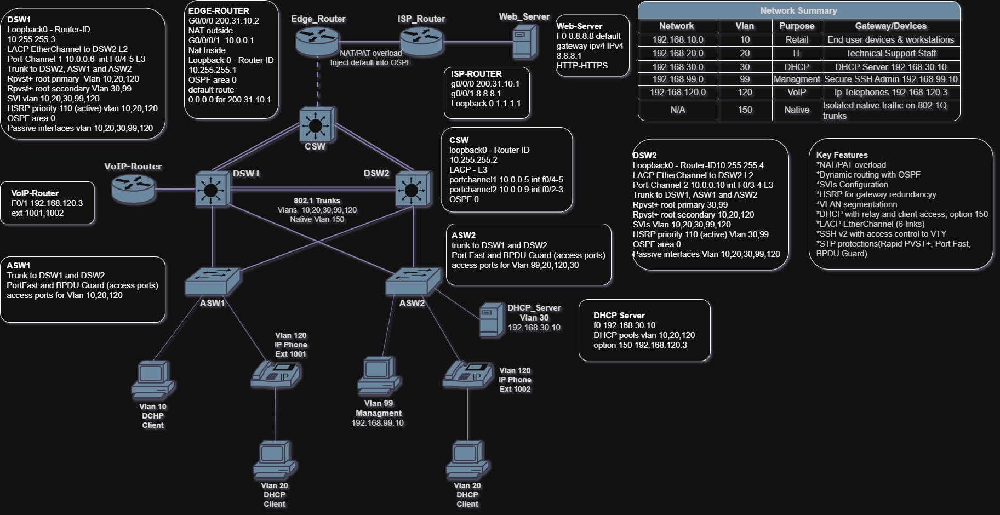
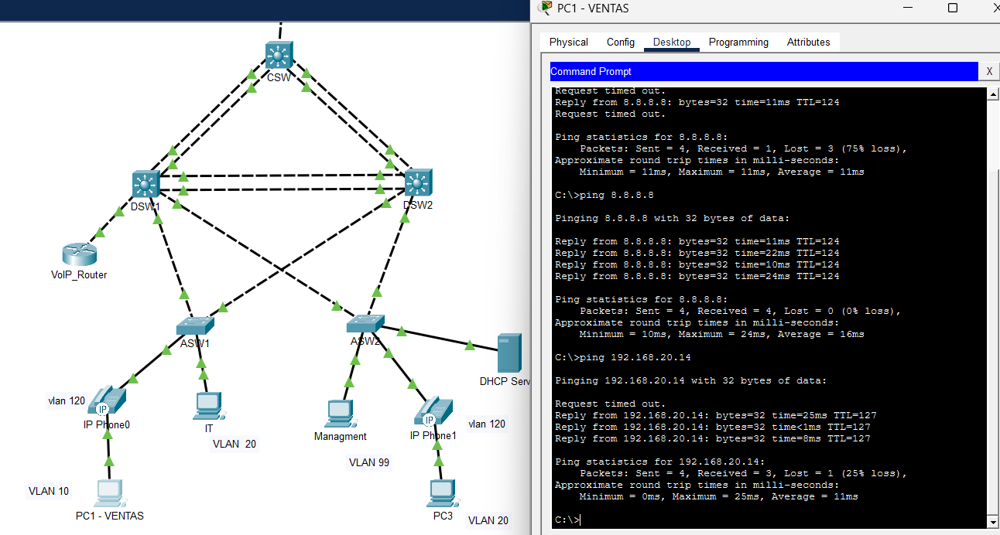
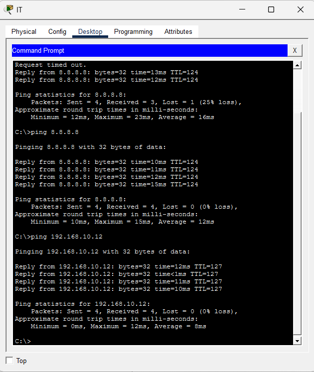
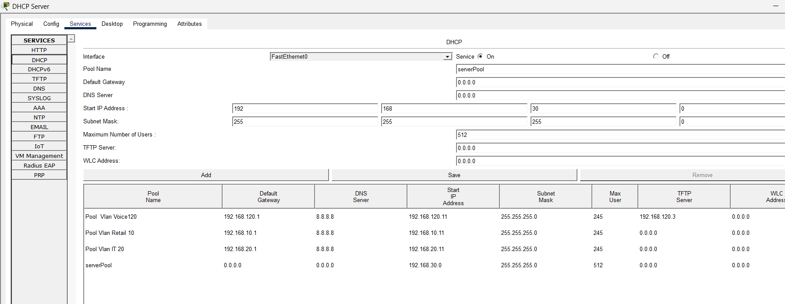
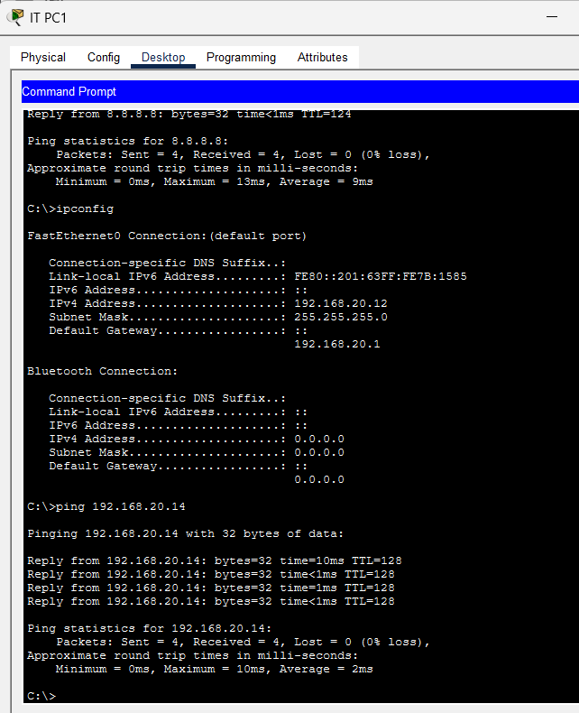
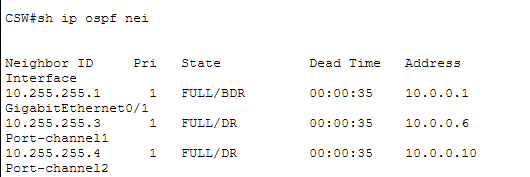
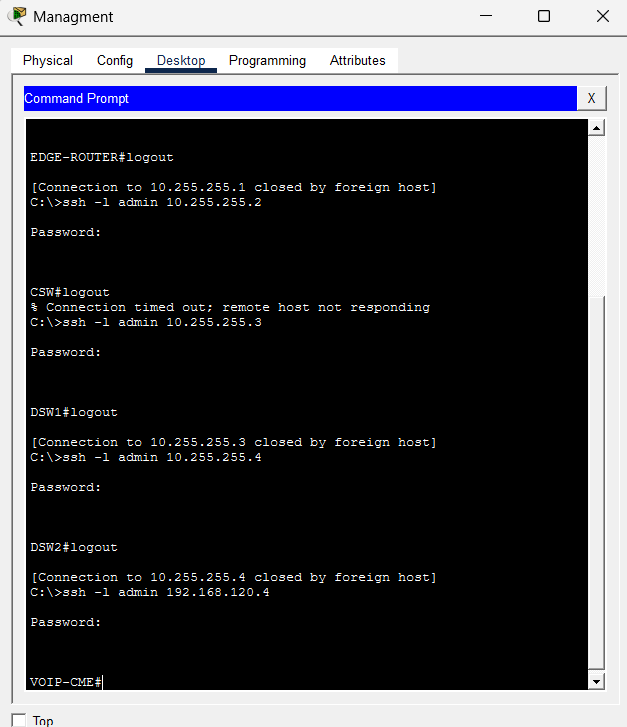
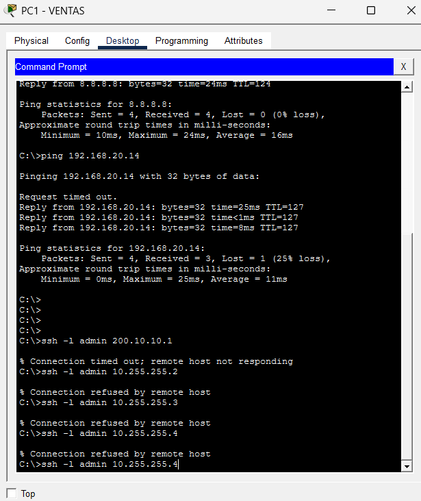
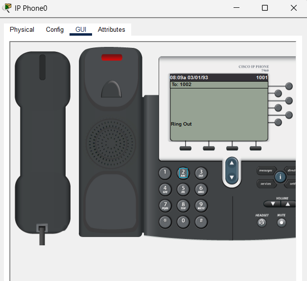

# Enterprise Campus Network Lab: OSPF, HSRP, Rapid PVST+, NAT/PAT, DHCP Relay and VoIP

A fully redundant enterprise campus network built in **Cisco Packet Tracer**. It follows a three-tier design (core, distribution, access) and combines Layer 3 routing, first-hop redundancy, VLAN segmentation, centralized DHCP, IP telephony, internet access through NAT/PAT, and secured remote management.
username admin
password AdminLab123!
enable password AdminLab123!



---

## Table of Contents
- [Skills Demonstrated](#skills-demonstrated)
- [Topology Overview](#topology-overview)
- [VLAN and IP Addressing Plan](#vlan-and-ip-addressing-plan)
- [Design Highlights](#design-highlights)
- [Configuration Highlights](#configuration-highlights)
- [Verification and Testing](#verification-and-testing)
- [Known Limitations](#known-limitations)
- [How to Run the Lab](#how-to-run-the-lab)
- [Repository Structure](#repository-structure)
- [Author](#author)

---

## Skills Demonstrated
| Area | What was implemented |
|---|---|
| **Switching** | VLANs, 802.1Q trunking with a dedicated native VLAN, LACP EtherChannel, Rapid PVST+, PortFast, BPDU Guard |
| **Routing** | OSPF (single area 0), static default route, default-route injection, loopback router-IDs, passive interfaces |
| **Redundancy** | HSRP v2 with preemption, STP root placement split across two distribution switches |
| **Layer 3 switching** | SVIs for inter-VLAN routing, routed port-channels between core and distribution |
| **Services** | Centralized DHCP with relay (`ip helper-address`), DHCP option 150 for IP phones, Cisco CME telephony |
| **Internet access** | NAT/PAT overload on the edge router with an ACL-defined inside range |
| **Security** | SSH v2, local authentication, VTY access-class restricted to the management subnet, isolated native VLAN |

## Topology Overview

| Layer | Devices | Role |
|---|---|---|
| **Internet** | `ISP-ROUTER`, `Web_Server` (8.8.8.8) | Simulated ISP and public web server (HTTP/HTTPS) |
| **Edge** | `EDGE-ROUTER` | NAT/PAT, default route to ISP, advertises default route into OSPF |
| **Core** | `CSW` | Layer 3 switch with routed port-channels to each distribution switch |
| **Distribution** | `DSW1`, `DSW2` | SVIs, HSRP, STP roots, DHCP relay, OSPF |
| **Access** | `ASW1`, `ASW2` | End-device ports, trunks to both distribution switches |
| **Services** | `DHCP_Server` (192.168.30.10), `VOIP-CME` | DHCP and IP telephony |

**Device count:** 3 routers (Edge, ISP, VoIP), 3 Layer 3 switches, 2 Layer 2 switches, 2 servers, 2 IP phones, 4 PCs.

**Traffic flow:** Hosts use the HSRP virtual IP as their gateway. Traffic bound for the internet goes DSW to CSW to EDGE-ROUTER, where PAT translates it to `200.31.10.2` before it reaches the ISP.

## VLAN and IP Addressing Plan

### VLANs
| VLAN | Network | Purpose | Notes |
|---|---|---|---|
| 10 | 192.168.10.0/24 | Retail | End-user devices, DHCP |
| 20 | 192.168.20.0/24 | IT | Technical support staff, DHCP |
| 30 | 192.168.30.0/24 | Servers | DHCP server `192.168.30.10` |
| 99 | 192.168.99.0/24 | Management | Only subnet allowed to SSH into devices |
| 120 | 192.168.120.0/24 | Voice | IP phones, VoIP router |
| 150 | N/A | Native | Unused by hosts; isolates untagged trunk traffic |

HSRP virtual IP is `.1` in every VLAN. DSW1 uses `.2` and DSW2 uses `.3` as physical SVI addresses.

### Infrastructure links
| Device | Interface | Address | Connected to |
|---|---|---|---|
| ISP-ROUTER | Gi0/0/0 | 200.31.10.1/30 | EDGE-ROUTER |
| ISP-ROUTER | Gi0/0/1 | 8.8.8.1/24 | Web_Server |
| ISP-ROUTER | Loopback0 | 1.1.1.1/32 | |
| EDGE-ROUTER | Gi0/0/0 (NAT outside) | 200.31.10.2/30 | ISP-ROUTER |
| EDGE-ROUTER | Gi0/0/1 (NAT inside) | 10.0.0.1/30 | CSW Gi0/1 |
| EDGE-ROUTER | Loopback0 | 10.255.255.1/32 | OSPF router-ID |
| CSW | Gi0/1 | 10.0.0.2/30 | EDGE-ROUTER |
| CSW | Po1 (Fa0/4-5) | 10.0.0.5/30 | DSW1 |
| CSW | Po2 (Fa0/2-3) | 10.0.0.9/30 | DSW2 |
| CSW | Loopback0 | 10.255.255.2/32 | OSPF router-ID |
| DSW1 | Po1 (Fa0/4-5) | 10.0.0.6/30 | CSW |
| DSW1 | Loopback0 | 10.255.255.3/32 | OSPF router-ID |
| DSW2 | Po2 (Fa0/2-3) | 10.0.0.10/30 | CSW |
| DSW2 | Loopback0 | 10.255.255.4/32 | OSPF router-ID |
| DSW1 / DSW2 | Po12 (Gi0/1-2) | Layer 2 trunk | Each other |
| VOIP-CME | Fa0/1 | 192.168.120.4/24 | DSW1 Fa0/1 (VLAN 120), default route via 192.168.120.1 |
| ASW1 | Vlan99 | 192.168.99.11/24 | In-band management, gateway 192.168.99.1 |
| ASW2 | Vlan99 | 192.168.99.12/24 | In-band management, gateway 192.168.99.1 |

**EtherChannels:** three LACP bundles of two links each (6 links in total): two routed port-channels (core to distribution) and one Layer 2 trunk port-channel between the distribution switches.

### DHCP pools (central server, relay on the SVIs)
| Pool | Default gateway | DNS | Range start | Extra |
|---|---|---|---|---|
| VLAN 10 Retail | 192.168.10.1 | 8.8.8.8 | 192.168.10.11 | |
| VLAN 20 IT | 192.168.20.1 | 8.8.8.8 | 192.168.20.11 | |
| VLAN 120 Voice | 192.168.120.1 | 8.8.8.8 | 192.168.120.11 | Option 150 (TFTP) = VOIP-CME `192.168.120.4` |

## Design Highlights
- **Load-balanced distribution layer.** DSW1 is the STP root and HSRP active gateway for VLANs 10, 20 and 120. DSW2 does the same for VLANs 30 and 99. Each switch is the backup for the other, so both are used and either can fail.
- **Routed core links.** Layer 3 port-channels between core and distribution avoid STP blocking and converge quickly with OSPF.
- **Passive SVIs.** OSPF advertises the VLAN subnets but sends no hellos toward users.
- **Dedicated native VLAN (150).** Reduces VLAN-hopping exposure; trunks only allow the VLANs in use.
- **Management isolation.** VTY lines accept SSH only from VLAN 99 (`access-class 99`).
- **Edge default route injection.** One static default route on the edge router is redistributed into OSPF with `default-information originate`.

## Configuration Highlights

Full sanitized configs are in [`configs/`](configs/). The key parts are below.

### HSRP and DHCP relay (DSW1, VLAN 10)
```
interface Vlan10
 description SVI Vlan 10 Retail
 ip address 192.168.10.2 255.255.255.0
 ip helper-address 192.168.30.10
 standby version 2
 standby 10 ip 192.168.10.1
 standby 10 priority 110
 standby 10 preempt
```

### STP root placement
```
! DSW1
spanning-tree mode rapid-pvst
spanning-tree vlan 10,20,120 priority 24576
spanning-tree vlan 30,99 priority 28672

! DSW2 (mirror image)
spanning-tree vlan 30,99 priority 24576
spanning-tree vlan 10,20,120 priority 28672
```

### LACP routed port-channel and trunk (DSW1)
```
interface Port-channel1
 no switchport
 ip address 10.0.0.6 255.255.255.252
!
interface range FastEthernet0/4 - 5
 no switchport
 channel-group 1 mode active
!
interface Port-channel12
 switchport trunk native vlan 150
 switchport trunk allowed vlan 10,20,30,99,120,150
 switchport mode trunk
```

### OSPF with passive SVIs (DSW1)
```
router ospf 1
 router-id 10.255.255.3
 passive-interface Vlan10
 passive-interface Vlan20
 passive-interface Vlan30
 passive-interface Vlan99
 passive-interface Vlan120
 network 10.0.0.4 0.0.0.3 area 0
 network 192.168.10.0 0.0.0.255 area 0
 ! ...remaining VLAN networks and loopback
```

### NAT/PAT and default route (EDGE-ROUTER)
```
interface GigabitEthernet0/0/0
 ip address 200.31.10.2 255.255.255.252
 ip nat outside
interface GigabitEthernet0/0/1
 ip address 10.0.0.1 255.255.255.252
 ip nat inside
!
router ospf 1
 default-information originate
!
ip nat inside source list 1 interface GigabitEthernet0/0/0 overload
ip route 0.0.0.0 0.0.0.0 200.31.10.1
access-list 1 permit 192.168.10.0 0.0.0.255
! ...one line per internal VLAN
```

### Access port hardening (ASW1)
```
interface FastEthernet0/4
 switchport access vlan 10
 switchport mode access
 switchport voice vlan 120
 spanning-tree portfast
 spanning-tree bpduguard enable
```

### Secure management (all devices except ISP-ROUTER)
```
ip ssh version 2
ip domain-name darlylab.local
access-list 99 permit 192.168.99.0 0.0.0.255
access-list 99 deny any
line vty 0 15
 access-class 99 in
 login local
 transport input ssh
```

### In-band management on access switches (ASW1)
```
interface Vlan99
 ip address 192.168.99.11 255.255.255.0
 no shutdown
ip default-gateway 192.168.99.1
```

### IP telephony (VOIP-CME)
```
ip route 0.0.0.0 0.0.0.0 192.168.120.1
!
telephony-service
 max-ephones 5
 max-dn 5
 ip source-address 192.168.120.4 port 2000
 auto assign 1 to 5
ephone-dn 1
 number 1001
ephone-dn 2
 number 1002
```

## Verification and Testing

### Link state and inter-VLAN routing (VLAN 10 host)
All links are up. A Retail PC (VLAN 10) reaches the internet server `8.8.8.8` through NAT/PAT and a host in VLAN 20 through the HSRP gateway and SVIs. The first packet in each test is lost while ARP resolves; the rest succeed.



### Inter-VLAN routing and internet (VLAN 20 host)
An IT PC (VLAN 20) pings `8.8.8.8` and a VLAN 10 host with 0% loss.



### DHCP server pools
Three pools (VLAN 10, 20, 120) with the HSRP virtual IP as default gateway; the voice pool carries option 150.



### DHCP lease (VLAN 20 client)
The client received `192.168.20.12/24` with gateway `192.168.20.1` (HSRP VIP).



### OSPF adjacencies on the core switch
CSW has FULL adjacencies with the edge router and both distribution switches.


### EtherChannel on DSW1
Po1 (routed, to CSW) and Po12 (Layer 2 trunk, to DSW2) are bundled with LACP.



### Secure remote management (SSH)
username admin
password AdminLab123!
enable password AdminLab123!
The management PC in VLAN 99 opens SSH sessions to the edge router, CSW, DSW1, DSW2 and the VoIP router.



### Management ACL blocks other VLANs
The same SSH attempts from a Retail PC (VLAN 10) are refused, proving that `access-class 99` limits device access to the management subnet.



### IP telephony
Extension 1001 calls extension 1002 through the Cisco CME router.



### Verification commands
| Test | Command | Expected result |
|---|---|---|
| OSPF neighbors | `show ip ospf neighbor` | Adjacencies in FULL |
| Default route | `show ip route ospf` | `O*E2 0.0.0.0/0` learned from EDGE-ROUTER |
| HSRP | `show standby brief` | DSW1 active for 10/20/120, DSW2 active for 30/99 |
| STP roots | `show spanning-tree root` | Roots match the planned VLAN split |
| EtherChannel | `show etherchannel summary` | Po1, Po2, Po12 in use (`SU` / `RU`) |
| NAT | `show ip nat translations` | Inside addresses translated to 200.31.10.2 |

## Known Limitations
- `ISP-ROUTER` is a simulated internet device and is not hardened with SSH or an ACL.
- Single edge router and single ISP link (no WAN redundancy).
- No port security, DHCP snooping or Dynamic ARP Inspection yet.

## How to Run the Lab
1. Install **Cisco Packet Tracer** (version used: _add version_).
2. Clone the repository:
   ```bash
   git clone https://github.com/<your-username>/<repo-name>.git
   ```
3. Open `lab/PROJECT1_Fase_7.pkt`.
4. Wait 1 to 2 minutes for OSPF and HSRP to converge, then run the verification commands.

> Lab credentials are intentionally not published (`<REDACTED>` in the configs). If you paste the configs into your own devices, set your own passwords and generate the RSA key once with `crypto key generate rsa modulus 1024` so SSH v2 works.

## Repository Structure
```
.
├── README.md
├── lab/
│   └── PROJECT1_Fase_7.pkt
├── configs/            (sanitized running-configs)
│   ├── EDGE-ROUTER.txt
│   ├── ISP-ROUTER.txt
│   ├── CSW.txt
│   ├── DSW1.txt
│   ├── DSW2.txt
│   ├── ASW1.txt
│   ├── ASW2.txt
│   └── VOIP-CME.txt
└── docs/
    ├── DarlyLab_drawio.png
    └── screenshots/
```

## Future Improvements
- Port security, DHCP snooping and Dynamic ARP Inspection
- Redundant edge routers and a second ISP
- AAA with RADIUS or TACACS+
- IPv6 addressing

## Author
**Darly Villa**
- GitHub: [@darlyvilla](https://github.com/DarlyVilla)
- LinkedIn: [Darly Villa](https://www.linkedin.com/in/darly-villa-37016b1b0/)

---
*Personal learning project built in Cisco Packet Tracer.*
